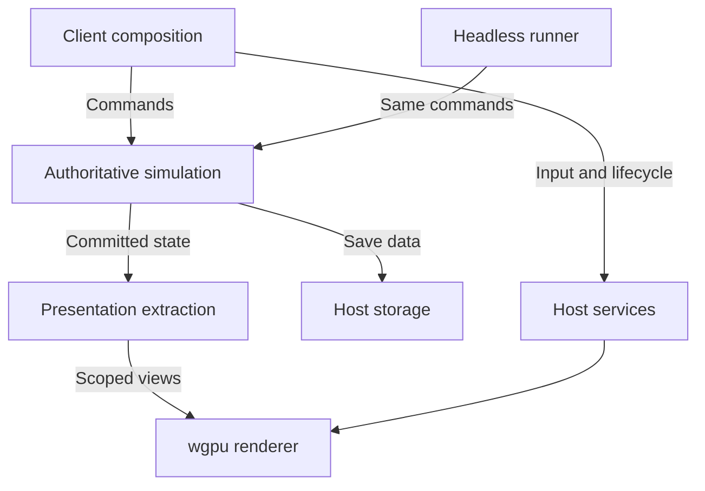

# Genesis engine architecture and incremental refactoring brief

**Project:** Genesis  
**Revision:** 1.0  
**Date:** 12 October 2026  
**Audience:** The Codex agent auditing and revising the existing source repository  
**Technology decision:** Rust, a custom engine, and wgpu. Do not adopt Bevy or its subsystem crates.

### Navigation

- [Scope and execution contract](#1-purpose-and-execution-contract)
- [Repository audit](#2-repository-audit-before-architectural-edits)
- [Ownership and module structure](#4-ownership-and-module-structure)
- [Simulation data and time](#5-domain-data-and-identity)
- [World and gameplay systems](#9-world-coordinates-terrain-and-spatial-ownership)
- [Renderer and host lifecycle](#14-presentation-extraction-and-the-custom-renderer)
- [Content and persistence](#16-content-assets-and-authoring)
- [Validation and performance](#18-observability-and-meaningful-validation)
- [Implementation phases](#20-incremental-implementation-plan)
- [Codex handoff prompt](#23-handoff-prompt-for-the-implementing-codex-agent)

## 1. Purpose and execution contract

Make Genesis easier to extend, inspect, test, and optimize over many years while preserving the existing playable application. Establish clear ownership of world state and durable boundaries between simulation, presentation, rendering, content, and platform integration.

Genesis is a 3D world, civilization, and colony simulator based on the Wheel of Heaven setting. The player belongs to the Elohim civilization. The immediate game concerns helping humans develop a civilization in the ancient Levant. Longer-term ambitions include primordial Earth, terraforming, the creation of life and ecosystems, and development across different epochs.

This brief specifies a direction for the existing implementation. It is not a source-code audit: no repository has been inspected in preparing it. Before changing code, establish what already exists, what works, and which recommendations address demonstrated problems.

### 1.1 Binding owner decisions

- Continue in Rust.
- Retain a custom engine based on wgpu.
- Do not introduce Bevy, including Bevy ECS, rendering, application, or other subsystem crates.
- Preserve the current game and useful existing code through incremental changes.
- Support a 3D colony simulation whose environmental and human systems can become deeper over time.
- Treat development sustainability, understandable behavior, and performance as architectural concerns.
- Keep the simulation independent of graphical presentation.

Earlier discussion of a Bevy or Unreal migration is superseded by this direction. Established non-Bevy libraries may remain. Using a library for a specific responsibility is compatible with a custom engine.

### 1.2 How to interpret requirements

**MUST** identifies an architectural invariant or a binding project constraint. **SHOULD** identifies a default that can be adapted with repository evidence and a recorded reason. **MAY** identifies an optional technique.

Apply requirements to the systems being changed and to existing systems where the invariant matters. A section describing hydrology, trade, or planetary regions does not authorize implementing an absent subsystem merely to complete a checklist.

Preserve working equivalents. Names, module examples, data layouts, and numerical workloads in this brief are proposals. Do not rename a functioning subsystem or replace an adequate dependency solely to match this document.

Follow the applicable repository instructions and the owner's current request. Resolve genuine instruction conflicts explicitly; do not modify instructions to bypass them. When asked to implement this brief, progress through ordinary reversible refactoring without turning each extraction into a separate approval request.

### 1.3 Required outcome

The architecture should make these statements true:

1. The same authoritative simulation can run through the interactive game and a headless runner.
2. There is one owner for each consequential quantity, identity, and relationship.
3. Commands enter through validation; presentation cannot independently mutate the world.
4. Logical simulation time and meaningful outcomes do not depend on render frame rate.
5. Runtime and persistent identity survive storage rearrangement.
6. Rendering and derived caches can be rebuilt from domain state and content.
7. Saves preserve the information required to continue the simulation.
8. Asynchronous work cannot overwrite newer state or choose history accidentally.
9. Performance changes have representative before-and-after evidence.
10. Each migration checkpoint leaves the retained game buildable and playable, subject to explicitly recorded baseline defects.

## 2. Repository audit before architectural edits

Read the applicable `AGENTS.md`, `CLAUDE.md`, contributor documentation, and existing architecture decisions. Identify the actual project root and relevant workspace members before searching broadly.

Use `rg` and `rg --files` for discovery. Inspect the dependency manifest and lockfile rather than inferring library versions from current online documentation.

### 2.1 Establish the baseline

Record:

| Area | Evidence to collect |
|---|---|
| Repository | Branch, commit, working-tree changes, generated files, established checkpoint practice |
| Toolchain | Rust channel/version policy, Cargo workspace, lockfile, build scripts, target features |
| Dependencies | wgpu version, windowing, math, serialization, entity storage, GUI, assets, profiling |
| Entry points | Interactive executable, initialization, event loop, update/render loop, shutdown |
| State | World owner, global resources, mutation paths, entity IDs, content definitions |
| Simulation | Time model, scheduling, random sources, navigation, domain interactions |
| Graphics | GPU ownership, extraction, uploads, passes, assets, surface lifecycle |
| Persistence | Existing save formats, loading behavior, compatibility promises, example saves |
| Platforms | Targets actually supported today, CI targets, known limitations |
| Validation | Existing tests, commands, scenarios, profiling tools, packaging process |

Trace at least one player action from input to its domain effect and back to the screen. Building placement is a useful example when implemented. Trace one terrain mutation, one resource transfer, and one save/load cycle where available.

Search for architectural risks as hypotheses, then verify their actual use. Examples include world state embedded in renderer types, direct UI mutations, frame-dependent consumption, entire-world clones, repeated global scans, unbounded work queues, transient IDs in saves, and obsolete worker results overwriting current data.

### 2.2 Preserve current behavior

Create a feature preservation ledger with the existing status of camera controls, world generation, selection, placement, construction, resource behavior, people, environmental behavior, interface, assets, persistence, and supported build targets.

Mark each feature as working, partial, intentionally absent, or already broken. Record reproduction steps for baseline failures. Do not silently attribute pre-existing failures to the refactor or expand the refactor to unrelated repairs.

Run the repository's normal validation first. Do not blindly enable every feature combination or turn every existing warning into a new blocking gate. Record exact commands and outcomes.

Retain one reproducible representative scenario. Prefer a populated scene doing actual work where the current game supports it. Record the seed, content version, commands, camera route, build profile, and machine. Do not invent a production/economy workload for a repository that does not yet implement those systems.

### 2.3 Preserve the owner's working tree

Keep unrelated tracked and untracked changes intact. Avoid destructive resets, broad cleaning, history rewriting, or wholesale generated-file replacement.

Keep structural changes distinguishable from intentional gameplay changes. Use focused diffs or commits according to repository practice. Never automatically include unrelated user work in a checkpoint.

### 2.4 Audit output

Before substantial edits, write a short repository-specific assessment containing:

- The actual dependency and ownership map, with file paths.
- The feature preservation ledger and validation baseline.
- Findings supported by inspected source or measurements.
- Existing components to retain.
- The smallest useful extraction.
- Save and platform compatibility implications.
- The next few implementation slices and their acceptance criteria.

Suggested destination: `docs/architecture/current-state.md`, adapted to existing documentation conventions. An audit is the first phase, not the final deliverable when implementation has been requested.

## 3. Architectural invariants

| ID | Invariant | Consequence |
|---|---|---|
| A01 | One authoritative world | A resource, person, inventory, or water quantity cannot have two independently mutable owners. |
| A02 | Headless execution | Advancing a scenario requires no window, graphics surface, renderer, audio device, or visual-only asset. Any required domain compute backend is explicit. |
| A03 | Commands validate at execution | A valid preview does not bypass domain validation. |
| A04 | Explicit logical time | Rendering, wall-clock jitter, and worker speed do not implicitly decide outcomes. |
| A05 | Stable domain identity | Array positions, pointers, GPU indices, and recycled slots are not durable references. |
| A06 | Derived presentation | Render and UI caches can be reconstructed from committed state. |
| A07 | Versioned derived work | Stale jobs are rejected using world identity and source revisions. |
| A08 | Bounded background work | Queues, uploads, caches, and histories have budgets or retention policies. |
| A09 | Durable world meaning | Saves identify schemas, content, time, identities, and pending commitments. |
| A10 | Measured optimization | A performance change cites a workload, baseline, result, and tradeoff. |
| A11 | Independent visual detail | Camera visibility does not silently stop consumption, weather consequences, or trade. |
| A12 | Incremental integration | Each adopted slice preserves a runnable checkpoint. |

These invariants do not require immediate threading, an ECS rewrite, a general engine framework, or a particular number of crates.

## 4. Ownership and module structure

### 4.1 Responsibilities

| Boundary | Owns | Excludes |
|---|---|---|
| Simulation | Domain state, logical time, rules, commands, scheduling, authoritative queries | Windowing, GPU resources, camera state, file dialogs, render pacing |
| Presentation extraction | Conversion of committed domain state into scoped render and UI views | Domain mutation and GPU submission |
| Renderer | wgpu resources, rendering passes, GPU caches, visual LOD, submission and recovery | Authoritative food, water, ownership, jobs, terrain rules, or economic state |
| Game client | Input mapping, camera, selection, placement preview, HUD, animation and sound presentation | Alternative implementations of domain rules |
| Host services | Event loop, storage, asset I/O, lifecycle, wall-clock pacing, worker integration | Settlement, ecological, or economic policy |
| Content | Validated definitions, stable definition IDs, asset manifests and versions | Mutable instances and GPU handles |
| Developer tools | Inspectors, scenario authoring, tracing, diagnostic commands | Unrestricted hidden mutation paths |
| Headless runner | Scenario execution, command playback, checks, metrics and benchmarks | A second simulation or graphical initialization |

The executable is the composition root. It constructs concrete services and connects them. Avoid making all state available through one global mutable engine context.

A runtime flow can be expressed as follows:



This diagram describes responsibility and data flow. The Cargo dependency graph must remain acyclic.

### 4.2 Start with a small workspace

The first valuable package boundary is the simulation library. Rendering, platform integration, and asset handling may initially remain well-defined modules in the existing application.

| Suggested unit | Initial scope |
|---|---|
| `genesis_sim` library | World, domain modules, IDs, logical time, commands, queries, save data |
| `genesis_client` application | Existing custom engine host, extraction, rendering, interface and platform adapters |
| Headless binary | Another binary target or small package that exercises `genesis_sim` without graphical dependencies |

Names are illustrative. Preserve established package names where useful.

Extract a separate renderer, content, or tools crate when a concrete dependency boundary, compilation benefit, or second consumer justifies it. Do not begin by creating a dozen empty crates.

The headless target must actually build without the renderer's dependency closure. Adding a second binary to a package with unconditional graphical dependencies may not achieve that. Use package separation or deliberate Cargo feature gates and verify the resolved graph. Cargo's workspace mechanisms support shared package management; they do not enforce domain boundaries automatically. [R1]

Distinguish headless execution from CPU-only execution. The ordinary baseline and validation path should remain CPU-only where it already is. If the audit finds an existing authoritative GPU solver, preserve working behavior behind an explicit compute backend that requires no window, surface, or display renderer. Document its canonical state ownership, hardware requirements, and reproducibility scope. Its wgpu dependency is a compute dependency, not permission for domain code to import the renderer. Do not claim that a GPU-dependent run validates CPU-only operation, and do not silently add a second solver during the first extraction. A CPU reference implementation or fallback is a separate scoped choice. Future GPU acceleration must retain a validated headless execution path.

Do not introduce an unbounded `common`, `core`, or `utils` crate. Shared units, identifiers, or content types should have a named responsibility.

### 4.3 Dependency direction

- Simulation MUST NOT depend on renderer, windowing, GUI, or client modules.
- The client MAY depend on simulation APIs and rendering APIs.
- The extractor MAY depend on simulation read APIs and presentation DTOs.
- A separate renderer SHOULD consume presentation types without importing the simulation implementation.
- A shared presentation contract, if extracted, MUST remain lightweight and independent of both implementations.
- Storage and asset I/O adapters live outside the simulation's world-advancement code.
- The simulation MAY use ordinary math, serialization, random-number, collection, and existing non-Bevy ECS libraries.

Reusing an ECS does not mean every domain belongs in it. Dependency independence also does not require inventing replacements for adequate libraries.

### 4.4 Engine mechanisms and game rules

Keep the custom engine specialized to Genesis: landscapes, water presentation, vegetation, buildings, people, overlays, authoring tools, and the required platform loop.

Use simulation modules to own the actual game rules. A generic renderer should not know how a crop becomes harvestable. A generic task executor should not decide who owns a granary. A material identifier should not determine a person's hunger state.

Introduce abstraction where there is an actual boundary or a second implementation. Do not build a plugin marketplace, general reflection framework, or universal scene system as a prerequisite.

## 5. Domain data and identity

### 5.1 Use complementary representations

| Domain | Default direction |
|---|---|
| Elevation, substrate, soil moisture, fertility, water fields | Chunked, contiguous numerical data |
| People, significant animals, buildings, inventories | Typed stores and compact component data |
| Broad vegetation and wildlife | Patch-level biomass or population state |
| Roads, irrigation infrastructure, trade connections | Graphs with explicit ownership, capacities and costs |
| Long-distance activity | Scheduled transfers, journeys and regional records |
| Visible foliage, crowds, meshes and effects | Derived presentation objects |

Retain the existing storage choice when it meets the required behavior and measured scale. Use profiling to decide whether a store should become more compact or be split by access pattern.

An individual blade of grass does not need a domain entity. An individually meaningful tree may have one. The distinction should follow gameplay requirements.

### 5.2 Identity categories

Keep these concepts separate:

1. **Persistent identity:** a person, building, inventory, settlement, shipment, or world.
2. **Runtime storage handle:** dense index, ECS entity handle, arena slot, or chunk offset.
3. **Content definition identity:** for example, `genesis:crop/barley`.
4. **Presentation identity:** an instance key or picking number used by a particular view.

Use typed IDs where they prevent mixing domains. Reuse an adequate existing ID scheme. Do not choose UUIDs or a particular integer width without a need.

If storage slots can be reused, stale handles must be detectable. Save the state needed by the authoritative ID allocator. Repacking a store or loading a world must preserve persistent references.

Display names and localized strings are not content IDs. Renaming a label must not break a save.

### 5.3 One owner per quantity

An inventory owns stored grain. A shipment owns grain in transit. A field owns its crop state. A reservoir or water cell owns stored water. A person owns their persistent identity and life state.

A settlement total is either derived from these records or is the sole owner under a documented aggregate representation. It cannot independently own stock that detailed records also count.

Derived indexes and summaries must identify their source revision or rebuilding rule. They must not become undocumented second authorities.

### 5.4 Units and numerical policy

Document the units of space, time, water, biomass, resource quantities, and economic values.

Use exact quantities for discrete inventories and currency, where those concepts exist. Continuous fields may use floating point with explicit tolerances, finite-value checks, and stable accumulation policies.

A recipe is a defined transformation; different resource types need not have numerically equal input and output counts. Conservation tests must account for modeled conversion factors, sources, sinks, spoilage, and losses.

Do not hide numerical instability by independently clamping many cells and ignoring lost mass. Report accounting error and fix the source or document an intentional approximation.

## 6. Logical time and scheduling

### 6.1 Simulation clock

Use one explicit integer-based logical timeline. Translate domain durations to that timeline through documented units. The host uses wall time to decide how much work to request; world rules do not inspect wall time.

Preserve the existing tick model initially if it can satisfy this boundary. A fixed base tick with scheduled events is a reasonable default. A well-defined discrete-event approach is also acceptable.

Fast-forward advances additional logical work. It must not silently omit consequential updates or multiply every numerical timestep.

If the machine cannot keep up, use a documented pacing policy: allow simulation time to advance more slowly, reduce the selected acceleration, or show the condition. Do not silently discard history to protect frame rate.

### 6.2 Different systems have different schedules

Frequent movement, staggered decisions, production, consumption, soil water, growth, weather, and geological changes need not execute at one frequency.

Choose intervals from gameplay and numerical requirements. Numerical solvers may need internal substeps. Newly introduced scheduling must preserve existing intended behavior before optimizing it.

Prefer sleeping inactive systems, invalidating cached plans when inputs change, and scheduling known arrivals or completions before adding more threads.

### 6.3 Explicit stages

Document the actual tick stages and when each stage observes writes. A candidate order is:

1. Admit ordered commands for the logical boundary.
2. Resolve scheduled work due at this boundary.
3. Advance environmental and domain systems according to their schedules.
4. Resolve competing intents and reservations.
5. Commit validated changes.
6. Record relevant facts and update derived indexes.
7. Publish a completed state for inspection, extraction, or saving.

This is a design example, not a mandated ordering. Preserve necessary dependencies. If later stages observe earlier commits, state that. If a solver reads a previous-state buffer, state that.

Keep the first implementation explicit and inspectable. A universal scheduler or event bus is unnecessary.

### 6.4 Determinism contract

Adopt a declared baseline such as:

> On the supported execution target and declared solver/backend profile, the same build, content manifest, initial state, random state, and command stream with assigned logical execution times and same-time ordering produce the same canonical domain state.

This does not promise bitwise equivalence across CPU architectures, compilers, future rule versions, or GPU backends. Multiplayer lockstep is a separate design decision.

Control consequential iteration order, pathfinding tie-breaks, conflicting writes, and numerical reduction order. Do not let random hash-map iteration determine who gets a scarce resource.

Assign RNG state or reproducible streams to stable domain work. Thread scheduling must not change which random draw belongs to which event. Save the relevant generator state or counters.

A canonical state fingerprint excludes storage layout, profiling counters, render state, and reconstructable caches. Define canonical ordering and floating-point handling instead of hashing raw Rust struct memory.

## 7. Commands, commits and domain events

### 7.1 Command semantics

Commands express intent and may be rejected. A placement preview is advisory.

A command envelope should carry the information needed to identify its world, order, action, and any required stale-state preconditions. The simulation or authoritative host assigns the accepted execution point.

Record the assigned logical execution point and same-time ordering in replay data. Replaying raw wall-clock input arrivals is not an equivalent contract.

Possible commands include placement, construction cancellation, terrain modification, job assignment, trade orders, and scientific interventions. Implement only those that correspond to current mechanics.

Validate resources, occupancy, ownership, relevant revisions, and target existence at execution. Return a structured accepted/rejected result with a useful reason.

### 7.2 Transactional domain operations

Use small domain transactions for coupled changes. A transfer debits one owner and credits another as one logical operation. Construction must not charge resources while failing to create the corresponding construction state.

Planning against a shared read view can produce conflicting intents. Resolve them in a stable order and commit the accepted subset. Reservations should specify ownership, quantity/capacity, lifetime, and release conditions.

Cancellation, death, demolition, route failure, or changed ownership must release or transfer affected reservations explicitly. Two workers must not both consume the same stock.

This requires careful domain APIs, not a general-purpose database transaction engine.

### 7.3 Events describe committed facts

Distinguish commands, planned intents, successful commits, and facts about completed transitions.

A rejected command must not emit a successful construction, payment, or shipment event. Facts should contain their logical time, identity, affected objects, and relevant context.

Keep three channels conceptually separate:

- Domain communication whose ordering affects the simulation.
- Historical facts retained for gameplay or debugging.
- Disposable presentation notifications such as sound and particles.

Losing a presentation notification must not lose goods or suppress a required domain transition. The client must be able to rebuild its display from authoritative state.

Avoid storing every low-level movement event indefinitely. Retain history according to explicit gameplay and diagnostic needs.

## 8. Concurrency and asynchronous work

### 8.1 Begin with one simulation owner

A single authoritative mutation thread is the default starting point. The renderer may initially run in a separate phase on the same thread. This already permits good boundaries and useful profiling.

Introduce parallelism where a measured workload benefits from it. Prefer independent read-only computation and disjoint data partitions, followed by explicit commits. Avoid a mutex on every person or a shared mutable world accessible to arbitrary worker tasks.

Parallelization can lose to memory traffic, synchronization, and cache behavior. Factorio's development reports provide concrete examples; benchmark Genesis's actual workload rather than assuming more workers will help. [R6]

### 8.2 Two classes of jobs

**Presentation jobs** produce meshes, instance placement, texture preparation, and other disposable results. They may complete at any wall-clock time.

**Authoritative jobs** determine paths, plans, field updates, or other consequences. Their inputs and commit rules must preserve the declared simulation semantics.

A job should carry enough identity to prove that its result still applies:

```text
Job identity
  world_epoch
  request_id
  target object or region
  source revisions
  job kind and configuration revision
  issuing logical time
  required commit point, for authoritative work
  device generation, for GPU-specific work
```

Use the smallest equivalent representation the repository needs. These are conceptual fields, not a required public struct.

### 8.3 Worker completion must not choose history

Sorting completed results is insufficient for deterministic execution. If timing decides whether a path is used this tick or the next, outcomes can still change.

Authoritative work needs a predetermined logical commit boundary and ordering. If the result is not ready, the baseline policy is to wait at that logical boundary or complete the calculation synchronously. Either choice may affect wall-clock speed while preserving world semantics.

An alternative that admits externally timed outcomes must record sufficient information for replay and declare the different contract. Do not introduce that complexity without a need.

Rejected stale results follow an explicit replanning or retry policy. Jobs must use immutable input snapshots, pinned read views, or another clear ownership mechanism; they must not read arbitrary live mutable state while computing.

### 8.4 Bounded work and cancellation

Give each queue a capacity or byte budget. Track pending and running work separately. Coalesce superseded mesh or cache jobs where safe.

Saturation of an authoritative job queue must not silently drop work or change its logical execution point. Apply backpressure to wall-clock advancement, retain scheduled work for deterministic execution, or complete it synchronously. Presentation work may use more permissive dropping or coalescing policies.

Cancellation means the result is no longer applicable; a worker may still finish. Validate the result before applying it. Late completion must never restore deleted entities, old terrain, or assets from another world.

Add concurrency only after the serial behavior can be reproduced. Avoid changing data representation, scheduling semantics, and threading in the same migration slice.

## 9. World coordinates, terrain and spatial ownership

### 9.1 Coordinate conventions

Document units, axes, handedness, angle conventions, and transform order. Preserve existing conventions unless a demonstrated problem requires migration.

A scalable direction is integer region/chunk/cell addressing plus local positions in meaningful world units. Use higher precision on the CPU where required by actual extent. Ordinary GPU geometry can use camera-relative floating-point coordinates.

Centralize conversions between simulation positions, terrain cells, rendering coordinates, and picking rays. Test negative coordinates and region boundaries; integer division and remainder semantics need particular care.

Origin rebasing changes presentation transforms. It must not alter persistent entity positions, ownership, or save identity.

A spherical Earth model is not a prerequisite for the colony slice. Keep geographic-to-local-region conversion at a named boundary, and record the chosen topology. Do not insert speculative spherical coordinates into every household or construction calculation.

### 9.2 Terrain representation

Retain the current representation when it supports the playable mechanics. A heightfield with substrate and soil layers is a reasonable surface-world default.

Caves, overhangs, tunnelling, and complex underground construction require a separate volumetric or hybrid decision. Preserve such mechanics if they already exist; do not create them merely because Dwarf Fortress is an inspiration.

Keep authoritative terrain separate from its visual mesh resolution. Building foundations, farm extents, and water quantities cannot change because a lower-detail mesh is displayed.

### 9.3 Three kinds of residency

Distinguish:

1. Authoritative simulation state and its chosen activity/model detail.
2. CPU-derived caches such as meshes, drainage helpers, and navigation structures.
3. GPU residency and visual level of detail.

Evicting a render chunk must not erase a village's food. An unloaded neighboring region must not be treated as empty terrain or zero water merely because it is not in a visual cache.

Use explicit boundary conditions or the authoritative regional model when a neighboring detailed region is unavailable.

### 9.4 Revisions and invalidation

Track source revisions for derived data. Separate geometry, soil, occupancy, hydrological connectivity, and navigation revisions where useful; an initial coarse revision is acceptable if it keeps implementation simple.

A terrain edit should:

1. Validate the command, affected area, constraints, and any resource cost.
2. Determine the required changes to terrain, existing water, occupancy, and foundations under the game rules.
3. Commit the validated coupled domain changes as one logical transaction at a simulation boundary.
4. Advance relevant revisions.
5. Mark drainage, navigation, vegetation placement, meshes, and other affected caches dirty.
6. Rebuild or update them through versioned work.

The edit transaction need not solve all future water propagation. Its immediate resulting state must be valid, with any subsequent redistribution explicitly scheduled. A failure cannot leave charged resources or changed terrain without their required coupled effects.

Include neighboring halos or border regions where algorithms depend on adjacent samples. An edit on a chunk edge must not leave the neighbor's mesh, route, or water connection permanently stale.

Use explicit invalidation between current systems. A universal dependency graph is optional.

### 9.5 Presentation lag and safety

Derived visuals may temporarily lag committed terrain. Define an acceptable behavior and expose pending work in development tools. Never let an old mesh overwrite a newer source revision.

Navigation and movement require stronger handling. Use authoritative local passability checks while derived navigation is stale, or schedule temporary blocking and subsequent navigation replacement at explicit logical boundaries. Worker completion time must not determine how long a route is unavailable or whether a person may move. A cache whose readiness changes outcomes is authoritative work under Section 8, even when its data is derived.

Changing visual terrain LOD needs consistent borders or deliberate seam treatment. It must preserve the world-space interpretation of roads, canals, footprints, and picking.

## 10. Weather, hydrology, geology and ecology

These sections describe ownership and interaction contracts. Deepen only the environmental systems already present or explicitly selected for the next playable feature.

### 10.1 Environmental fields

Use spatial fields with defined units, neighborhood access, boundary behavior, and update schedules. Keep their resolution independent of display meshes and of each other where useful.

Treat numerical solver state as authoritative when it affects gameplay. Derived visualization colors, surface normals, waves, and particles remain presentation.

Record the assumptions of each model: what it represents, its inputs and outputs, which approximations it makes, and which player decisions it supports.

### 10.2 Weather

Begin with the model the game needs: seasonal forcing, rainfall, temperature, wind, and regional variation as applicable. Weather generates explicit inputs for water and ecological systems.

Separate ambient rain particles and cloud rendering from actual rainfall quantities. Turning off a visual effect must not stop rain reaching the soil.

Do not require a global atmospheric solver to support a local agricultural settlement. A later climate model should enter through explicit regional conditions and fluxes.

### 10.3 Water accounting

Give hydrology a defined accounting model. For example:

```text
change in modeled stored water
  = precipitation and explicit external inflow
  - evaporation, extraction and explicit external outflow
  + net transfers between modeled compartments
```

Transfers between included compartments cancel in the total balance. If groundwater is not modeled, infiltration into it must be recorded as an explicit boundary sink rather than disappearing without explanation.

Store volume directly or define how depth and cell area determine volume. Specify units for flow rates and integration intervals.

Required properties for implemented water systems:

- Outflows cannot collectively exceed the available volume.
- Interface transfers are counted once.
- Numerical error is bounded and measured against a documented tolerance.
- Changed resolution preserves stored volume.
- Terrain edits define how existing water is redistributed or displaced.
- Boundaries do not invent or delete water implicitly.
- Dry cells, steep gradients, and wetting transitions have stable behavior.

A local grid, catchment model, channel graph, or hybrid may be appropriate. Select the least complex model that produces the desired decisions. Narrow irrigation channels may use explicit connections or local refinement instead of increasing the entire world's grid resolution.

Do not make GPU water rendering the only record of the world's water. Authoritative GPU computation is a possible later optimization, with explicit readback, scheduling, portability, and reproducibility costs.

### 10.4 Geology and soil

Initially, geology may mean generated bedrock, soil depth, mineral deposits, terrain constraints, and local changes. Tectonics or geological epochs can run as generation or historical processes.

A generator seed alone is not durable world state if future generator changes would produce a different world. Persist modified canonical data and the generation metadata needed to interpret any regenerated portions.

Regeneration also requires an available compatible generator implementation and its required input definitions. Before removing that implementation, migrate or materialize the canonical data needed by supported saves. A version label for an unavailable generator is not a compatibility strategy.

Soil interactions should identify their owners: moisture, fertility, erosion, deposition, compaction, and biomass contributions where implemented. Distinguish extensive quantities from intensities such as concentration.

### 10.5 Flora and fauna

Use species definitions separate from mutable instances or population patches. Give each implemented ecological process explicit effects on relevant stocks and conditions.

Broad vegetation may be represented by biomass, cover, age classes, or species distribution per patch. Individually meaningful trees or animals may retain identities.

Domestic animals, named animals, hunted individuals, and wildlife cohorts need not share one representation. A conversion between them must account for the quantities and identities the game promises to retain.

Ecological depth should come from meaningful interactions: water, grazing, growth, resource use, habitat, and disturbance. Avoid implementing organism-level detail that has no gameplay or explanatory value.

### 10.6 Scientific interventions

Represent Elohim capabilities as explicit domain commands or scheduled processes. Their validation, costs, limits, timing, and consequences belong in the simulation.

A crop variant, habitat change, irrigation intervention, or biological introduction should affect the same environmental and economic systems used by ordinary gameplay.

An intervention should produce inspectable effects. Record enough context to explain what changed and why, without requiring permanent storage of every numerical intermediate.

## 11. People, construction, resources, trade and society

### 11.1 Persistent humans

For the colony slice, the default is persistent identity for every represented human. Keep identity, household, relevant relationships, ownership, needs, and significant life state independent of visible character objects.

A person can remain an individual while planning less frequently or representing a journey by a scheduled arrival. Simplification must not silently erase relationships or commitments.

For future planetary populations, record a separate product decision about whether every human remains persistent, selected individuals persist, or remote populations use anonymous cohorts. Optimization must not choose this accidentally.

### 11.2 Needs and decisions

Use small, explainable decision processes before broad agent frameworks. Keep the state required to explain hunger, rest, work, shelter, access, social satisfaction, and other implemented needs.

Avoid all-pairs relationship scans. Store meaningful relationships sparsely and use local or indexed queries.

Decision frequency can differ from movement frequency. Reconsider plans when relevant conditions change, at scheduled decision points, or when a current task fails.

Expose reasons: no reachable food, reserved materials unavailable, path invalidated, home inaccessible, or competing priority. These explanations should support both debugging and future player-facing inspection.

### 11.3 Work and logistics

Represent jobs and work commitments separately from visual animation. Model ownership of tasks, reserved inputs, assigned workers, capacity, progress, and completion.

Use spatial or domain indexes to find relevant opportunities. Do not scan the entire world for every worker on every update.

When a route, building, inventory, or worker becomes invalid, update the commitment and release resources explicitly. A task cannot remain permanently reserved by a deleted person.

Production should use validated recipes and defined transformations. Distinguish physical storage, reservations, available stock, and goods already in transit.

### 11.4 Construction and placement

Construction should have explicit states sufficient for current mechanics: proposed, validated/started, awaiting materials or work, in progress, completed, cancelled, or failed.

Validate footprint and terrain in the domain. The renderer provides a preview; it does not decide whether construction exists.

Resource consumption, staged deliveries, work progress, cancellation refunds, demolition, and salvage must follow documented rules. Do not add all possible states until the game needs them, but avoid encoding construction solely as a visual scale animation.

### 11.5 Trade and economy

Start from real inventories, transport, commitments, and access. Prices, barter rates, currency, and market policy belong in game rules according to the intended economic model.

A shipment has one owner for its goods while in transit. Departure, arrival, loss, rerouting, and cancellation are explicit transitions. Cross-region movement must not duplicate cargo or passengers.

Keep trade contracts and scheduled obligations durable where they affect future state. Distinguish aggregates used for reporting from authoritative inventories.

Do not introduce an economy whose rules only work while both settlements are rendered.

### 11.6 Social structure and history

Model households, communities, institutions, ownership, and relationships to the depth the game currently uses. Prefer explicit state and meaningful events to a universal social graph.

Define retention for significant history. Current needs, a family relationship, and a historical event have different storage and update requirements.

Keep historical flavor, era-specific rules, and content definitions separate from engine mechanisms. The same rendering and scheduling infrastructure should support changing cultural and technological content.

## 12. Navigation and movement

Navigation is gameplay infrastructure because reachability affects work, resources, construction, and survival. It must not depend solely on whatever visual mesh is currently loaded.

Retain an existing satisfactory grid, navigation mesh, or graph. Choose a replacement only from demonstrated requirements.

### 12.1 Required contracts

- Routes reference meaningful world positions and topology.
- Cached paths record the revisions they depend on.
- Changed terrain, occupancy, or transport links invalidate relevant routes.
- Immediate movement validates passability when its assumptions may be stale.
- Agent disappearance and task cancellation release path-related commitments.
- Tie-breaking is stable within the declared determinism contract.
- Unreachable destinations return a reason and a defined replanning policy.

Hierarchical regional routes, portal graphs, shared destinations, and localized replanning are later options if profiling supports them. Do not recompute every route when one local wall changes.

### 12.2 Movement and representation

Authoritative position and journey progress belong to the simulation. Character animation and interpolation derive from them.

A distant journey may use a scheduled transfer if the model preserves its travel time, cargo, passengers, and relevant interruption rules. Visual disappearance cannot complete a journey early.

Keep collision or avoidance decisions that affect outcomes in the declared simulation model. Cosmetic foot placement and purely visual animation need not be authoritative.

## 13. Multiple regions, simulation detail and epochs

### 13.1 Distinguish three optimization mechanisms

1. **Visual LOD:** meshes, shadows, animation, visible instance density.
2. **Activity scheduling:** staggered decisions, sleeping systems, scheduled completions.
3. **Model detail:** explicit individuals or cells versus aggregate dynamics.

Use the first two before introducing extensive model changes. They often preserve behavior more directly.

### 13.2 Simulation detail policy

Define why a region uses a particular authoritative model. Camera movement alone must not become an exploit that avoids hunger, drought, transport time, or other consequences.

A detail policy may consider player-controlled settlements, active interventions, proximity to important interactions, or explicitly activated regions. Document it and keep transitions repeatable.

Coarse and detailed models generally produce different trajectories. Promise preservation of specified state and approximation bounds; do not claim exact behavioral equivalence merely because totals match.

### 13.3 Conversion contract

Before adding fine/coarse transitions, specify:

- Which model owns each quantity before and after conversion.
- How stored goods, water, biomass, and populations transfer.
- Which persistent people and relationships remain.
- How reservations, contracts, journeys, and scheduled events survive.
- How averages or densities are recomputed from extensive quantities.
- What approximation is introduced and how it is measured.
- How reversals and repeated transitions avoid drift or duplication.

Cross-region flows need a single interface owner or deterministic arbitration. Compute a boundary transfer once and apply matching changes to both sides over a defined logical interval.

### 13.4 Era transitions

Different epochs may use different processes while sharing durable world data. Terraforming can establish geography and conditions; ecosystems and settlements can operate within and modify them.

An epoch transition is an explicit transformation with a source state, rules/content version, and resulting state. Do not require all eras to execute every geological and human process simultaneously.

Implement epoch machinery when a playable transition requires it. Preserve the current colony loop while leaving the relevant data ownership clear.

## 14. Presentation extraction and the custom renderer

### 14.1 A small render-facing contract

The renderer receives committed presentation data. This can begin as a borrowed immutable view within a single-threaded update/render sequence.

A conceptual API boundary is:

```text
Simulation
  validate and execute ordered commands
  advance logical work
  expose committed queries and inspection data
  produce or accept versioned save data

Presentation extractor
  select the relevant view scope
  map stable domain objects to visual and UI records
  publish a complete snapshot or a valid delta

Renderer
  reconcile presentation records with its disposable caches
  prepare GPU resources
  render a frame for the selected camera and quality profile
```

These are contracts to map onto existing code, not function signatures to paste blindly.

Presentation records may identify a logical mesh, material, animation state, position, building stage, water surface, or overlay value. They must not expose mutable domain storage or put GPU handles into domain state.

Avoid a full-world copy every frame. Start with scoped extraction and profile it. Add changed ranges, immutable chunk snapshots, or revision-aware extraction where those reduce a measured cost.

### 14.2 Versioned updates

If producer and consumer become asynchronous, a useful update envelope is:

```text
PresentationUpdate
  world_epoch
  interest_revision
  simulation_tick
  sequence
  payload:
    FullSnapshot(scope, records)
    OR Delta(base_sequence, upserts, removals)
```

A world epoch changes when a different world, save, or replay branch becomes active. It is a transient invalidation generation, distinct from persistent world identity.

An interest revision identifies the region or subscription covered by an update. Record revisions identify versions of individual objects or chunks.

Use monotonic sequences within each world and view scope. Reject stale updates, including complete snapshots older than the latest accepted sequence. A view change explicitly establishes a new baseline; an old subscription cannot replace it.

A full snapshot must define which scope it replaces, including how absent records are removed. A delta must apply to an exact baseline for the same world and view.

### 14.3 Backpressure and delivery semantics

Bound pending presentation memory and work. Independent complete snapshots can use a latest-value mailbox.

Never drop arbitrary deltas, tombstones, or records required to reconstruct a valid state. If a delta chain is missing, request or publish a complete replacement baseline for that scope.

Coalescing is valid only when it preserves a complete replacement, retains deletions, or replaces the entire baseline. Loading a new world resets the relevant caches and subscriptions.

Authoritative commands, command results, and consequential domain events require their own delivery semantics. They must not share a disposable render mailbox.

Test a deliberately slow renderer. It may display older state, but memory must remain bounded and it must eventually converge to the current state.

### 14.4 Animation and picking

Interpolate presentation between known committed states. Do not feed interpolated transforms back into authoritative simulation.

Define handling for new entities, removed entities, teleports, new worlds, and origin changes. Do not interpolate between unrelated identities or coordinate frames.

GPU picking results are asynchronous. Retain the corresponding frame's mapping from picking numbers to stable object references. Associate it with world/view generation and discard stale results.

A visual hit becomes a world-space query or command. The simulation validates whether the target still exists and the action remains valid.

### 14.5 Render structure

Preserve the existing functioning renderer. A small explicit pass schedule is sufficient initially: relevant shadow passes, terrain and opaque objects, foliage, water/transparency, postprocessing, overlays, and UI.

For each pass, document its inputs, outputs, resource lifetimes, and ordering requirements. A generic render graph is optional when actual complexity justifies it.

Establish clear policies for:

- Render-target resizing and formats.
- Mesh, material, texture, and pipeline cache keys.
- Buffer capacity growth and reuse.
- Per-frame upload work and queue budgets.
- GPU memory accounting and eviction.
- Foliage, crowd, shadow, and terrain detail.
- Shader and material versions.
- Device-generation invalidation.
- CPU timing and optional GPU timing.

Do not make bindless resources, GPU-driven rendering, compute culling, or a sophisticated graph mandatory before the baseline needs them.

### 14.6 Visual direction and asset budgets

The desired direction combines readable colony composition with stylized landscapes and expressive detail. Use a coherent reference scene to judge it.

Create budgets for visible animated people, foliage density, texture memory, shadows, terrain uploads, and draw preparation on a named machine and quality profile. These are measurements and adjustable targets, not inferred capabilities of Rust or wgpu.

Prefer clear silhouettes, building functions, construction states, readable terrain, and ecological overlays. Art changes should flow through content and renderer boundaries without requiring changes to resource or household logic.

## 15. wgpu and host lifecycle

### 15.1 Follow the pinned API

Use the version resolved by the repository's lockfile. Current online documentation may expose types or enum variants that do not exist in the prototype.

Do not combine a wgpu upgrade with the initial simulation extraction unless a concrete dependency issue requires it. Select the version-specific documentation before implementing API calls. [R2]

### 15.2 GPU ownership

Give surface configuration, frame acquisition, submission, presentation, and recovery one clear owner. CPU workers may prepare data; they should not independently reconfigure or present the surface.

Use explicit lifecycle states or equivalent well-defined behavior: initialization, ready, suspended, reconfiguration, recovery, and unrecoverable failure.

Required handling for the supported platform:

- Query surface capabilities and use supported formats and modes.
- Request the device features and limits required by the actual rendering profile.
- Treat advanced capabilities as optional unless explicitly required.
- Avoid configuring zero-sized drawable surfaces.
- Release outstanding acquired frame resources before reconfiguration as required by the pinned API.
- Handle transient acquisition failures without busy loops or unnecessary world resets.
- Distinguish surface recreation from device recreation.
- Invalidate GPU caches on device loss and rebuild from CPU descriptors and content.
- Keep validation errors actionable rather than suppressing them indefinitely.
- Use bounded recovery behavior and preserve authoritative world state if graphics cannot recover.

wgpu documents configuration preconditions and device capability contracts. The precise error handling must follow the pinned release. [R3] [R4]

### 15.3 Reconstructable resources

Rendering GPU resources are caches of data or descriptions available elsewhere. Recreating the renderer must not regenerate a different landscape, reset the simulation seed, or lose a building's inventory.

If a documented authoritative compute backend uses GPU-resident working state, distinguish it from render caches. Define canonical ownership, snapshot/readback or recovery behavior, and what happens on device loss. Renderer recovery must not silently discard that state. A GPU compute path does not remove persistence or headless-execution requirements.

GPU-specific jobs carry device generation. A completion associated with an old device cannot publish into the new device's resource tables.

Keep enough CPU metadata or reloadable cooked content to rebuild assets. Avoid retaining every source byte indefinitely when it can be safely reloaded under a known budget.

### 15.4 Host services

Keep actual platform differences behind narrow adapters:

- Asset byte access.
- Save load/store operations.
- Worker execution and completed results.
- Monotonic wall-clock pacing.
- Window, input, lifecycle, and audio integration.
- Diagnostics and user-facing error reporting.

The simulation should receive validated content and explicit commands or results. It should not await arbitrary file I/O halfway through a logical update.

Profiling may measure wall-clock execution time. Those measurements must not become inputs to domain decisions.

### 15.5 Platform matrix

Preserve the targets actually supported by the repository. The earlier macOS, browser, console, and possible VR ambitions should be recorded as current requirements or future goals after examining the project; they are not all automatic refactor gates.

| Concern | Native implementation | Browser implementation when supported |
|---|---|---|
| Event loop | Native window/lifecycle integration | Cooperate with the browser event loop and visibility lifecycle |
| Work scheduling | Native workers where useful | Explicit worker integration; shared memory only when configured and supported |
| Assets | Packaged or development files | Fetched and cached assets |
| Persistence | Recoverable file replacement/commit | Async transactional/versioned browser storage with error and quota handling |
| Timing | Monotonic host clock | Host timing subject to browser scheduling and suspension |
| Graphics | Chosen native wgpu backend/profile | Explicit browser capability profile |

The normal Rust `wasm32-unknown-unknown` target does not provide ordinary filesystem and native-thread behavior. Browser support requires an actual host implementation. [R5]

Do not assume that a native feature works in a browser merely because wgpu is used. Select supported capabilities and provide a deliberate fallback or clear unsupported-profile result.

Console and XR work require their own feasibility decisions and toolchains. Do not infer a shipping path from desktop compilation alone.

## 16. Content, assets and authoring

### 16.1 Definition and instance separation

Definitions describe species, buildings, recipes, needs, materials, and other authored concepts. Instances describe the mutable state of particular people, fields, structures, and inventories.

Keep stable logical content identity separate from a content fingerprint/version and from a GPU handle.

The same definition can have different visual representations at different distances or eras without changing the identity of its world instances.

### 16.2 Content pipeline

Start with the existing usable source formats. A practical flow is:

1. Authored definitions and source assets.
2. Validation and import.
3. Cooked output and a manifest.
4. CPU asset metadata and residency.
5. GPU resources and presentation bindings.

A cooker is an incremental tool to solve actual asset problems. It need not begin as a sophisticated database.

Validate references, units, footprints, recipe quantities, material slots, animation names, and collision data where applicable. Report source-file context for errors.

Cache keys should include relevant source fingerprints, importer version, and target profile. Keep source assets, cooked products, runtime caches, and user saves distinct.

### 16.3 Hot reload

Visual changes may be prepared and validated before swapping at a safe frame boundary. A failed visual reload retains the last working asset and reports the problem.

Simulation-definition changes have stronger consequences. Editing crop yield or recipe inputs changes the world rules.

Default to new-scenario application, or use an explicit paused migration with a recorded effective tick and content version. Do not silently reinterpret a running world's inventories or obligations using whatever definition file happens to be newest.

A display-name or visual-material change should not require the same machinery as a rule change.

### 16.4 Missing content

Missing visual content may use a placeholder. Missing authoritative definitions require a supported migration, an explicit substitution policy, or an actionable incompatibility error.

Renamed content IDs need aliases or migrations. Do not silently remove unknown buildings and their occupants or stock from an existing save.

### 16.5 Developer tools

Prioritize tools that answer real development questions:

- Entity and household inspection.
- Job, reservation, and inventory inspection.
- Terrain, water, soil, and connectivity overlays.
- Navigation and dirty-region visualization.
- Logical time, scheduled work, queue, and revision inspection.
- Scenario loading, command playback, and selected interventions.
- Per-system timing and allocation diagnostics.

Use the same domain commands for gameplay and tools where semantics match. Special debug actions should be explicit and traceable.

Scenario-editor undo should use reversible authoring operations. Do not promise general gameplay undo across arbitrary elapsed simulation history.

Retain an existing useful GUI library. A new editor framework is not a prerequisite for these tools.

## 17. Persistence and compatibility

### 17.1 Audit saves before changing their meaning

Identify existing save formats, examples, and compatibility promises before changing storage, IDs, content, or random-number behavior.

If existing saves are fragile, protect them before the corresponding refactor phase. If no saves exist, introduce a modest initial schema; do not build a universal migration system for hypothetical future formats.

### 17.2 Save the state required to continue

A save manifest and payload should capture, where relevant:

| Category | Necessary information |
|---|---|
| Interpretation | Save schema, simulation/rule compatibility, content pack identities and versions |
| World | Persistent world identity, geography/topology metadata, logical time |
| Generation | Generator versions and the seed or parameters used where regeneration is allowed |
| Randomness | Required RNG state, counters, or reproducible streams |
| Objects | Persistent IDs, ownership, relationships and identity allocator state |
| Environment | Canonical modified terrain, water, soil, ecological state |
| Economy | Inventories, reservations, construction, production and shipments |
| Future work | Scheduled events, journeys, contracts, and consequential pending commitments |

Persist domain meaning rather than raw pointers, Rust memory layout, collection addresses, GPU handles, or transient instance indices.

A seed is insufficient to recover modified terrain or to guarantee identical generation after the generator changes.

Serialization libraries assist with encoding. Schema design, compatibility, and migration policy remain project responsibilities. [R8]

### 17.3 Save boundary and pending jobs

Capture a consistent state at a completed logical boundary. A save cannot contain one side of a transfer without the other.

For pending authoritative work, either finish it before snapshotting or preserve enough input and scheduling information to reproduce its outcome. Discarding a job is safe only when recomputation preserves the declared semantics.

Completing a pending calculation for saving must not advance its original logical commit time. Preserve the result and scheduled commitment where necessary, or the inputs needed to recompute it. Saving cannot make a future arrival, path decision, or production result take effect early.

Presentation jobs and GPU caches may be rebuilt. Avoid making the save depend on their wall-clock completion.

A staged snapshot or immutable chunk scheme may reduce pause time later. Start with a correct measured implementation before adding concurrent serialization complexity.

### 17.4 Safe loading and writing

Decode, migrate, and validate into a staged world. Check required content, references, units, numerical validity, and domain invariants before replacing the active world.

If loading fails, retain the current valid world and report the cause.

Migrations operate on a copy. Use a recoverable platform-appropriate commit procedure for writes, and keep the prior valid save when an incomplete write occurs. Native files and browser storage require different implementations.

Do not overwrite the only existing save while experimenting with a new schema.

Apply size and count limits to malformed data before making unbounded allocations. This is basic robustness for a save/import path.

### 17.5 Three distinct promises

- **Save compatibility:** an older world can be interpreted or migrated.
- **Replay compatibility:** a recorded sequence can reproduce its intended run under the required code/content version or migration contract.
- **Determinism:** a defined execution environment and inputs produce the same outcomes.

A save loading successfully does not imply unchanged future behavior after a rule change. An input log alone does not reproduce an old run under arbitrary new code.

Keep small fixtures for supported save versions and explicit compatibility metadata. Record intentional rule changes separately from structural refactors.

## 18. Observability and meaningful validation

### 18.1 Explain the world

Make the important state transitions inspectable. Useful records include command outcomes, current task and blocking reason, inventory availability versus reservations, recent environmental inputs, navigation revisions, and scheduled commitments.

Diagnostic views should identify their logical tick and world epoch so stale data is recognizable.

Instrument domain stages and costly operations without allowing profiling to affect outcomes. Keep logs structured enough to correlate a command, its commit, and the resulting changes. Use retention limits for traces and histories.

### 18.2 Test dangerous boundaries

Add or retain tests that protect meaningful behavior:

| Area | Example check |
|---|---|
| Commands | A rejected request causes no partial effects attributable to that request and emits no success fact. |
| Resources | Transfers and reservations cannot duplicate stock or exceed valid capacity. |
| Ownership | Deleting or cancelling a task releases or transfers its claims correctly. |
| Time | Different render rates preserve the declared simulation behavior. |
| Identity | Store repacking and save/load preserve persistent references. |
| Jobs | Reordered completions preserve declared deterministic outcomes; stale results are rejected. |
| Terrain | Boundary edits invalidate relevant neighboring data. |
| Navigation | Changed passability prevents movement through invalid routes. |
| Water | Storage and explicit source/sink terms balance within the declared tolerance. |
| Presentation | A skipped delta triggers resync; deletion and world changes cannot leave permanent ghosts. |
| Saves | Round trips preserve canonical state and subsequent scheduled behavior. |
| Content | Missing incompatible definitions fail clearly; supported renames migrate. |
| Model detail | Applicable transitions preserve promised quantities and identities. |

Only implement tests for systems that exist or are part of the current slice. Use property-based or randomized checks where they expose realistic invariants; do not create tests that merely repeat implementation code.

Avoid broad snapshot tests over incidental memory layout or every UI pixel. Use a small number of reference scenarios and targeted visual smoke checks to protect meaningful behavior.

### 18.3 Headless runner

Provide a minimal way to load a scenario, select a seed, supply commands, advance a specified amount of logical time, save state, and report metrics or a canonical fingerprint.

The executable name and interface should follow the repository. A possible command shape is:

```text
genesis-headless run --scenario valley --seed 42 --ticks 5000
genesis-headless replay --scenario valley --commands scenario.commands
genesis-headless verify-save --input example.save
```

These commands are proposed interface examples, not existing commands. Build only the useful initial subset. Do not implement a second set of rules in the runner.

### 18.4 Reference scenarios

Retain a compact set of scenarios appropriate to implemented mechanics:

- Existing baseline world and controls.
- Populated settlement performing work.
- Conflicting reservations or scarce resources.
- Terrain or road change during a journey.
- Wet/dry boundary or water transfer across chunks.
- Construction cancellation or entity deletion during work.
- Save/load with pending commitments.
- World replacement while presentation work remains in flight.

Use fixed logical workloads for simulation checks. Use a repeatable camera route and quality settings for rendering checks. Distinguish known baseline failures from regressions.

## 19. Performance and memory budgets

### 19.1 Measure before replacing

Record the hardware, OS, toolchain, build profile, dependency versions, adapter/backend, resolution, quality profile, scenario, content manifest, seed, and commands.

Separate:

- Domain simulation by subsystem.
- Navigation and job computation.
- Presentation extraction and reconciliation.
- Renderer CPU preparation.
- GPU execution where timing support exists.
- Asset loading, uploads, and cache behavior.
- Save/load time and peak memory.
- Queue depth, queued bytes, and stale-result counts.
- Long-session memory growth.

Report median and tail timings. A smooth average can hide a large terrain-edit, harvest, save, or upload spike.

GPU timestamp support is an optional instrumentation capability. Its absence must not prevent CPU measurement or gameplay.

### 19.2 Explicit throughput targets

Set performance goals for a named target machine and a real workload after the baseline is known.

For illustration, 20 logical ticks per second at normal speed and 4x acceleration require 80 ticks per wall-clock second. That leaves 12.5 ms per tick on average before overhead. A separate 60 fps goal permits approximately 16.7 ms per rendered frame. Shared CPU, memory, and GPU work still need to fit together.

These figures are examples, not Genesis shipping requirements.

Increasing populations such as 100, 1,000, and 10,000 can be diagnostic load points if the existing mechanics support them. They do not establish a performance claim unless people actually navigate, consume, work, and interact.

### 19.3 Optimize in evidence-driven order

Investigate avoidable work and poor access patterns before replacing languages or adding infrastructure:

1. Whole-world scans and unintended quadratic behavior.
2. Repeated pathfinding or decision-making on unchanged inputs.
3. Inactive systems updated unnecessarily.
4. Excessive allocations, pointer chasing, or large hot records.
5. Full-world extraction and redundant GPU uploads.
6. Cache invalidation, synchronization, or memory bandwidth.
7. Parallel work with enough granularity to benefit.
8. Specialized CPU or GPU algorithms for a demonstrated bottleneck.

This is a diagnostic order, not a compulsory sequence. Factorio's published examples of sleeping inactive systems and memory-limited parallelization are useful background. [R7]

Every optimization should preserve a comparable workload and state its behavior tradeoffs. Stop broadening performance work when the relevant budget is met.

### 19.4 Budget long-lived memory

Track authoritative state, derived CPU caches, GPU caches, pending jobs, histories, and saves separately.

Define eviction and retention only for data that can be discarded or reconstructed under the model. Required person identities, inventories, and commitments are not caches.

Check object churn, repeated world loads, terrain edits, and prolonged accelerated play for growth. Avoid unbounded duplicate requests and tombstone/history accumulation.

## 20. Incremental implementation plan

Adapt this sequence to repository evidence. Protect existing saves before changing their representation. Preserve working subsystems and do not build every future feature described above.

### Phase 0 — Audit and baseline

**Work:** Complete Section 2, run established checks, record the preservation ledger, and identify the first extraction.

**Exit evidence:** Repository-specific ownership map, baseline commands/results, known failures, save/platform implications, and a short prioritized plan.

**Constraint:** No wholesale restructuring based on assumed defects.

### Phase 1 — Isolate world advancement

**Work:** Establish a simulation library or equivalent enforceable boundary. Centralize logical advancement. Retain the current implementation inside that boundary where possible. Introduce a minimal headless runner.

**Exit evidence:** The interactive application and headless runner exercise the same rules. The headless dependency closure needs no window, surface, or renderer initialization. Any existing GPU-dependent domain computation is separately identified under Section 4.2; CPU-only validation is claimed only when actually performed. The retained scenario still works.

**Constraint:** Do not combine this extraction with a new ECS, new scheduler, new renderer, and library upgrades.

### Phase 2 — Clarify authority, IDs and commands

**Work:** Remove demonstrated duplicate ownership. Separate definitions from instances. Establish durable references and command validation for the existing actions being revised. Fix coupled mutations with domain transactions where needed.

**Exit evidence:** Ownership is documented for changed domains. Stale or invalid commands fail safely. Existing object references and resources remain valid. Save compatibility is protected before identity/storage changes.

**Constraint:** Do not replace a satisfactory ID or entity store just to standardize terminology.

### Phase 3 — Establish presentation and derived-work boundaries

**Work:** Extract committed views, make render caches reconstructable, and add source revisions where asynchronous derived work exists. Separate host lifecycle from domain rules.

**Exit evidence:** Rendering can pause, rebuild its caches, or switch worlds without corrupting the simulation. Delayed jobs cannot overwrite newer state. Selection, placement, terrain, and existing visual behavior remain usable.

**Constraint:** Begin on one thread if that is simpler. Delta streams and threading are optional until useful.

### Phase 4 — Harden saves, content and lifecycle

**Work:** Formalize schema/content metadata, staged loads, recoverable writes, required compatibility fixtures, visual versus rule reload behavior, and relevant wgpu lifecycle handling.

**Exit evidence:** Representative saves round-trip. Supported older saves load or migrate. Failed loads preserve the active world. Resize/suspend/recovery behavior is checked on the supported environment.

**Constraint:** If a platform or device-loss path cannot be exercised, document the unverified path accurately. Do not report it as tested.

### Phase 5 — Optimize a measured bottleneck

**Work:** Profile a representative scenario, select one meaningful bottleneck, change its data access or algorithm, and compare equivalent runs.

**Exit evidence:** Before/after metrics, domain behavior checks, and documented tradeoffs. If no performance improvement is achieved, retain the change only for a separately justified benefit.

**Constraint:** No unsupported FPS, population, planet-scale, or multithreading claims.

### Phase 6 — Continue the playable game

**Work:** After the architectural slice is stable, connect the next authorized mechanic through the established boundaries. A water-to-food-to-household loop with one Elohim intervention is a coherent direction.

**Exit evidence:** A playable scenario demonstrates consequences across existing systems and provides explanations for the player.

**Constraint:** This phase is a future development path unless feature work is included in the current request. It is not a prerequisite for completing an architectural refactor.

### 20.1 Checkpoint discipline

At each checkpoint:

1. Review the diff for unrelated changes.
2. Run the relevant established checks and targeted new checks.
3. Exercise the preserved gameplay path when the change can affect it.
4. Record compatibility and performance implications.
5. Keep the next step small enough to integrate and verify.

Use short architecture decisions for consequential choices, such as time semantics, identity, coordinates, terrain topology, compatibility, threading, or model-detail transitions. Do not create governance for routine implementation details.

## 21. Definition of done for an adopted refactoring slice

A slice is complete when its relevant conditions are satisfied:

- The source findings motivating it are documented.
- The retained build targets still build, or pre-existing/externally blocked failures are distinguished.
- The affected gameplay path remains usable.
- Domain ownership and dependency direction are clearer and enforceable.
- The headless scenario uses the same simulation logic when the slice concerns simulation.
- Commands and coupled mutations preserve their required invariants.
- New asynchronous work has revision and bounded-queue semantics.
- Save/content compatibility has been preserved or an explicitly authorized change is documented.
- Relevant meaningful checks pass.
- Performance-motivated changes include comparable measurements.
- Documentation identifies what changed, what remains uncertain, and the next useful step.
- No prohibited engine migration or unrelated infrastructure was introduced.

Do not mark the entire architecture implemented because folders were renamed. Conversely, a useful first slice does not need every future contract implemented in absent systems.

### 21.1 Required Codex checkpoint report

Report concisely:

1. Source and instructions inspected.
2. Problems actually found.
3. Files and boundaries changed, and why.
4. Existing behavior preserved and intentional behavior changes.
5. Validation commands/results, including baseline failures.
6. Performance evidence where relevant.
7. Save, content, and platform implications.
8. Remaining risks and the next small step.

Suggested records are `docs/architecture/current-state.md`, a concise refactor log, and a small number of architecture decision records. Adapt locations to repository practice.

## 22. Decisions that remain open

Resolve these from existing code, current design documentation, and measurements before asking the owner. Ask only when the answer materially changes the work and cannot be inferred safely.

| Decision | Safe initial stance |
|---|---|
| Current release platforms | Preserve proven targets; distinguish future ambitions. |
| Scale of persistent humans | Retain all currently represented identities; do not introduce anonymous aggregation implicitly. |
| Underground terrain | Preserve existing capability; surface terrain is sufficient unless underground interaction is a requirement. |
| Simulation timing | Preserve intended behavior while separating logical time from rendering. |
| Multiplayer | No new networking or cross-platform lockstep requirement. |
| GPU-authoritative fields | Keep existing correct implementation; require evidence before migration to GPU. |
| Scripting and modding | Separate data definitions now; add executable extension systems only when required. |
| Planetary and epoch continuity | Name the boundary and preserve state meaning; implement transitions when gameplay needs them. |
| Save compatibility window | Honor existing promises and fixtures; define a modest policy where none exists. |
| Renderer quality profile | Measure the representative scene on actual target hardware. |

Record these as decisions or open items. Do not stop all independent refactoring merely because a later planetary or platform question is unanswered.

Future networking, distributed simulation, general plugin systems, arbitrary scripting, full planetary physics, and advanced GPU architectures require their own justification and scope. They are not prerequisites for sustainable Rust/wgpu code.

## 23. Handoff prompt for the implementing Codex agent

Place this file in the repository's documentation area, preferably `docs/architecture/GENESIS_ENGINE_ARCHITECTURE.md` if no established location exists. Then give the agent the following instruction, with the path adjusted if necessary:

```text
Read docs/architecture/GENESIS_ENGINE_ARCHITECTURE.md in full and follow the
applicable repository instructions.

Genesis stays in Rust with its custom wgpu engine. Do not introduce Bevy or
Bevy subsystem crates, and do not begin an engine or language migration.

Audit the current repository before diagnosing it. Preserve unrelated user
changes, working gameplay, supported targets, and existing save compatibility.
Use the document as a target direction, not as evidence that the current code
is wrong or as a requirement to implement every future subsystem.

Produce a concise source-based current-state assessment and feature
preservation ledger. Identify the smallest useful architectural extraction,
then implement the first coherent migration slice with relevant verification.
Continue beyond a plan when implementation is possible and authorized.

Prefer establishing headless simulation execution, clear state ownership,
explicit logical time and commands, and a derived presentation boundary.
Preserve working equivalents. Do not simultaneously replace storage,
scheduling, rendering, and dependencies.

Record source paths, changes, validation results, compatibility implications,
measured performance where relevant, and the next useful step. Distinguish
baseline failures and untested paths from regressions and verified behavior.

Ask only for a concrete missing decision that blocks the affected action.
Continue independent reversible work when later decisions remain open.
```

## 24. Primary implementation references

These references support specific library behavior and development examples. The architecture choices above are Genesis design recommendations. Verify the documentation for the repository's pinned dependency versions before writing code.

- **[R1] Cargo workspaces:** [The Cargo Book](https://doc.rust-lang.org/cargo/reference/workspaces.html). Workspace organization and shared package management.
- **[R2] wgpu project and supported backends:** [gfx-rs/wgpu](https://github.com/gfx-rs/wgpu). Scope of the GPU abstraction, backend support, and release policy.
- **[R3] wgpu surface API:** [Surface documentation](https://docs.rs/wgpu/latest/wgpu/struct.Surface.html). Surface capabilities and configuration requirements; select the pinned version.
- **[R4] wgpu device API:** [Device documentation](https://docs.rs/wgpu/latest/wgpu/struct.Device.html). Requested capabilities, device behavior, and version-specific methods.
- **[R5] Rust browser target:** [wasm32-unknown-unknown](https://doc.rust-lang.org/rustc/platform-support/wasm32-unknown-unknown.html). Limits of ordinary filesystem and threading APIs on this target.
- **[R6] Parallelization and cache behavior:** [Factorio Friday Facts 215](https://www.factorio.com/blog/post/fff-215). A firsthand example of parallel work becoming slower because of cache interaction.
- **[R7] Avoiding unnecessary work:** [Factorio Friday Facts 421](https://www.factorio.com/blog/post/fff-421). Sleeping inactive entities and measured optimization of real simulation workloads.
- **[R8] Serialization tooling:** [Serde overview](https://serde.rs/). Serialization support; application schema and compatibility policy remain separate responsibilities.

[R1]: https://doc.rust-lang.org/cargo/reference/workspaces.html
[R2]: https://github.com/gfx-rs/wgpu
[R3]: https://docs.rs/wgpu/latest/wgpu/struct.Surface.html
[R4]: https://docs.rs/wgpu/latest/wgpu/struct.Device.html
[R5]: https://doc.rust-lang.org/rustc/platform-support/wasm32-unknown-unknown.html
[R6]: https://www.factorio.com/blog/post/fff-215
[R7]: https://www.factorio.com/blog/post/fff-421
[R8]: https://serde.rs/
